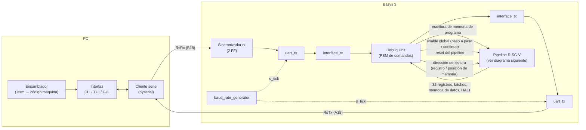
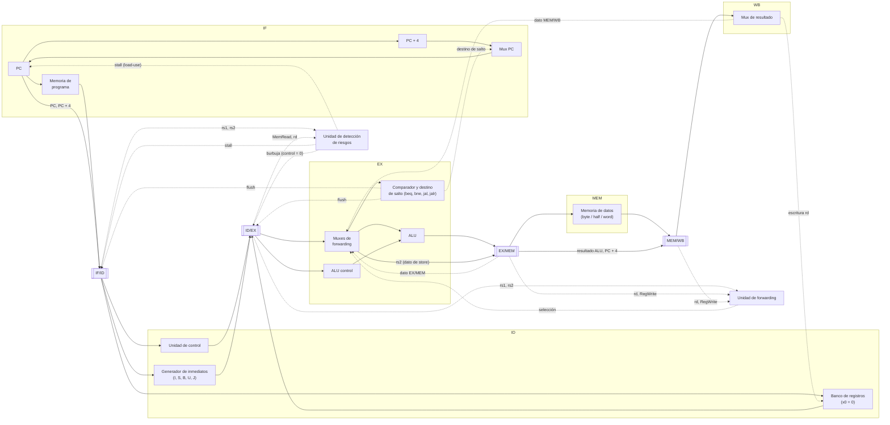
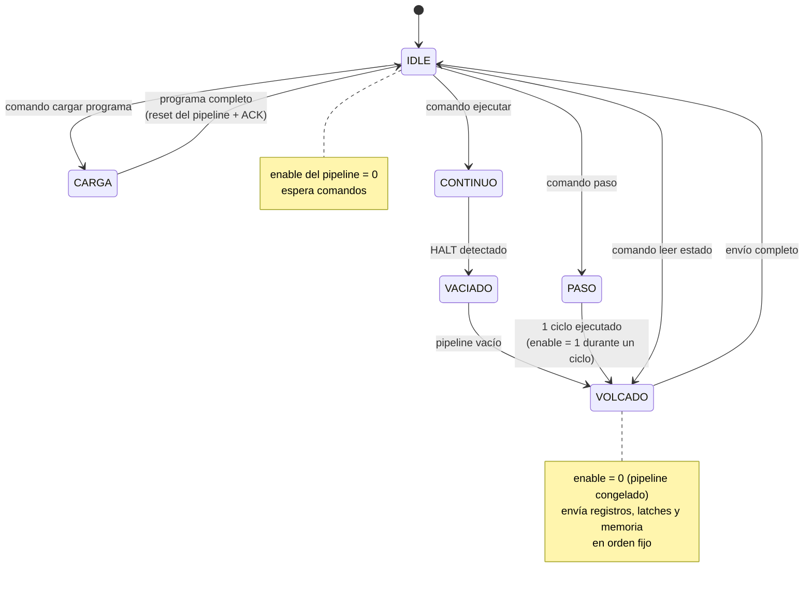

# Plan de trabajo — TP Final: Pipeline RISC-V + Debug Unit

**Equipo:** Molina, Maria Wanda (**A**) · Verdú, Melisa Noel (**B**)
**Placa:** Basys 3 (Artix-7 XC7A35T, clock de 100 MHz, puente USB-UART integrado)
**Repo:** [wandamol1405/AdC-Tps](https://github.com/wandamol1405/AdC-Tps), carpeta `TP-FINAL/`, rama de integración `dev-tpf`
**Herramientas:** Vivado, Verilog, Python (pyserial, igual que la GUI del TP2)

> Este archivo vive en el repo y se sincroniza en los Projects de Claude de ambas.
> Después de cada cambio importante: `git push` → la otra hace "Sync now" en su Project.

Leyenda de responsables: **A** = Wanda · **B** = Melisa · **A+B** = juntas

## Estado al 06/11/2026

- **Fase 0 casi cerrada:** estructura de carpetas creada, `.gitignore`, y convenciones de código y de ramas acordadas en [`docs/decisiones.md`](docs/decisiones.md) (§1, PR #71, issue #27). Faltan los ítems marcados abajo.
- **Fase 1 empezada:** los 10 testbenches de TP1 y TP2 pasan con Icarus Verilog (`iverilog -g2012`). La revisión de código de la ALU y la UART ya está volcada en las listas de abajo.
- **Próximo paso:** cerrar la Fase 1 (decisión reutilizar/adaptar/reescribir en `decisiones.md`) y arrancar la Fase 2 con las decisiones abiertas del diagrama.

---

## Diagrama en bloques

> Primera versión, para discutir en la Fase 2. GitHub renderiza estos diagramas Mermaid directamente.

### Sistema completo



El clock de 100 MHz (o el que salga del Clock Wizard en la Fase 7) llega igual a todos los bloques. El modo paso a paso se resuelve con la señal de **enable**, nunca cortando el clock. El enable tiene que frenar **todo** lo que guarda estado: PC, latches, escritura del banco de registros y escritura de la memoria de datos.

Para el volcado, la Debug Unit lee los 32 registros y la memoria de datos uno por uno: el banco de registros necesita un **tercer puerto de lectura** (o un mux en la dirección de uno de los dos) y la memoria de datos un **segundo puerto** (o un mux), igual que la memoria de programa para la carga.

### Pipeline RISC-V



Correcciones respecto de la primera versión del diagrama: el comparador de saltos toma los operandos **después** del forwarding; el dato de store (rs2 forwardeado) y el resultado de la ALU viajan por EX/MEM y MEM/WB sin pasar por la memoria; PC + 4 llega hasta WB para `jal`/`jalr`; las unidades de forwarding y de riesgos muestran de dónde leen; y el stall inserta una burbuja en ID/EX.

Decisiones abiertas que muestra el diagrama (registrar en `docs/decisiones.md`):

- **Dónde se resuelven los saltos:** en EX (como está dibujado, penalidad de 2 ciclos) o adelantado a ID (1 ciclo, pero requiere forwarding hacia ID y un stall extra si el operando viene de un load).
- **Riesgo WB → ID:** el forwarding cubre EX/MEM y MEM/WB, pero una instrucción que lee en ID el registro que se escribe en WB en el mismo ciclo lee el valor viejo. Resolverlo con bypass interno en el banco de registros (si se escribe y se lee el mismo registro, sale el dato nuevo) o escribiendo en el flanco de bajada.
- **Operandos de la ALU:** además del forwarding, hace falta un mux para elegir rs2 o inmediato, y otro para rs1 o PC (`auipc`, y `lui` con 0 + inmediato).
- **`jalr`:** el destino es `(rs1 + imm)` con el bit 0 en 0, así que pasa por el forwarding igual que la ALU.
- **Cómo se detecta HALT:** al decodificarse en ID o al llegar a WB. Para que el pipeline quede vacío al terminar conviene frenar el PC al ver HALT y esperar a que llegue a WB.
- **Memorias:** IP Block Memory de Vivado o registros inferidos. Las Block RAM tienen lectura sincrónica (un ciclo de latencia), lo que cambia en qué etapa sale el dato. La memoria de programa necesita un segundo puerto (o un mux) para que la Debug Unit la escriba, y la de datos uno para que la lea.

### Modelo de control: comando → respuesta (decisión tomada)

El TP2 funciona "a demanda": al cambiar A o B la salida cambia sola y `result_sender` envía cada vez que detecta un cambio. Ese modelo **no se usa** en el TP final, porque:

- El estado del pipeline cambia en cada ciclo de clock: enviar "cuando cambia" saturaría la UART.
- Un volcado (registros + latches + memoria) son cientos de bytes y tiene que corresponder a **un único ciclo**.
- `result_sender` descarta estados intermedios; en paso a paso cada ciclo tiene que verse.
- El paso a paso y la carga de programa necesitan órdenes explícitas, con el procesador detenido.
- Si la FPGA envía cuando quiere, la PC no sabe cuántos bytes esperar y puede desalinearse.

Reglas del nuevo modelo:

1. **La PC es la maestra.** La FPGA nunca envía datos sin que se los pidan.
2. **La Debug Unit es la única que maneja el enable del pipeline.** El pipeline no avanza si ella no lo habilita.
3. **Durante el volcado el pipeline está congelado** (enable = 0), así todos los datos son del mismo ciclo.
4. **Toda respuesta tiene formato fijo** (por ejemplo: cabecera + longitud + datos + checksum opcional), definido en `docs/protocolo.md`.
5. **La carga de programa se hace con el procesador detenido**, y al terminar se resetea el pipeline.

Esquema de estados de la Debug Unit (primera versión):



Del TP2 se reutiliza: handshake con la bandera de `interface_tx`, estructura de FSM de `loader_uart`, sincronizador de `rx` y la idea de la "foto" para garantizar consistencia.

A definir en la Fase 2: qué pasa si no hay HALT (¿límite de ciclos? ¿comando de parada desde la PC?) y si después de cada paso se vuelca todo automáticamente o la PC lo pide aparte.

---

## Fase 0 — Organización (semana 1)

- [x] **A+B** Crear la carpeta `TP-FINAL/` con la estructura de abajo
  - [ ] Faltan `gui/` y `README.md`
- [x] **A+B** `.gitignore` para Vivado (`.runs/`, `.cache/`, `.sim/`, `.Xil/`, `.hw/`, `.ip_user_files/`, `*.jou`, `*.log`, `*.bit`, `__pycache__/`). Quedó en `TP-FINAL/`, no en la raíz
  - [ ] Agregar `*.vvp` (salidas de Icarus) y llevarlo a la raíz o sumar uno ahí: hoy quedan sin ignorar `tb_uart_rx.vvp`, `TP2/tb_loader_uart.vvp` y `TP2/gui/__pycache__/`
- [x] **A+B** Convenciones de código, reset y flujo de ramas (`main` ← `dev-tpf` ← `dev-tpf-<N>-...`, PR revisado por la otra): ver `docs/decisiones.md` §1
- [x] **A+B** Conectar el repo a ambos Projects de Claude y excluir PDFs e imágenes al configurar archivos
- [x] **A+B** Crear `TP-FINAL/docs/decisiones.md`
- [x] **A+B** Crear issues y milestones en GitHub a partir de este plan (ya existe al menos la #27; falta completar el resto y los milestones por fase)

## Fase 1 — Revisión de TPs anteriores (semana 1)

Objetivo: decidir, módulo por módulo, si se reutiliza tal cual, se adapta o se reescribe. Primera revisión del código actual del repo ya incluida.

### TP1/TP2 — ALU (`TP2/rtl/ALU.v`)

- [x] Ancho parametrizable (`NB_DATA`): se instancia con 32 bits
- [x] Es combinacional pura
- [ ] **Quitar la saturación en ADD:** hoy satura ante overflow; en RISC-V `add`/`addi` tienen que dar la vuelta (wrap-around) sin excepción
- [ ] **Agregar operaciones faltantes:** `SLL`, `SLT`, `SLTU`
- [ ] **NOR** no se usa en RISC-V (se puede dejar o sacar)
- [ ] **Opcodes:** son los de MIPS (`100000` = ADD, etc.). Definir una codificación propia y un módulo **ALU control** que la genere desde opcode/funct3/funct7
- [ ] **Shifts:** limitar el monto a `i_b[4:0]` (en RV32 solo cuentan los 5 bits bajos)
- [ ] Revisar si `i_enable` y las banderas `o_overflow` / `o_carry` siguen haciendo falta (RISC-V no usa flags; los saltos comparan directo). Ojo: con `i_enable = 0` la salida se fuerza a 0, así que si se deja hay que atarlo a 1
- [ ] `lui` y `auipc` se resuelven con ADD (0 + imm y PC + imm) si existe el mux de operandos del diagrama; si no, hace falta una operación que pase B tal cual
- [ ] Ampliar `TP1/sim/tb_ALU.v` con los casos nuevos

### TP2 — UART

- [x] `baud_rate_generator` es parametrizable (`CLK_FREQ`, `BAUD_RATE`)
- [x] El sincronizador de `rx` (2 FF con `ASYNC_REG`) existe, pero está en `top.v`: **moverlo** o copiarlo al top del TP final
- [ ] Decidir velocidad: hoy es 19200. A 115200 con 100 MHz el divisor da 54,25 → se trunca a 54 (~0,5 % de error, aceptable). Recalcular cuando cambie el clock en la Fase 7
- [ ] `uart_rx`, `uart_tx`, `interface_rx`, `interface_tx`: reutilizar tal cual, verificando que sus testbenches pasen
- [ ] `interface_tx` guarda un solo byte: evaluar si hace falta un **FIFO** para enviar registros + latches + memoria sin trabar a la Debug Unit
- [ ] `loader_uart` y `result_sender` se reemplazan por la **Debug Unit**, pero su estructura de FSM (comando + valor, envío de bytes con bandera de ocupado) sirve de base. Ojo: `result_sender` envía "cuando cambia" la ALU; ese comportamiento no se mantiene (ver modelo comando → respuesta)
- [ ] GUI del TP2 (`TP2/gui/`): reutilizar `serial_link.py`, la idea de `protocol.py` y el `mock_fpga.py` para probar la interfaz sin placa

### General

- [x] ¿Pasan los testbenches originales? Sí: los 8 de TP2 y los 2 de TP1 dan `TODOS LOS CASOS PASARON` con `iverilog -g2012` (06/11/2026)
  - TP1 `top.v:74` da un warning de ancho (`reg_bank.i_data` espera 6 bits y recibe 8). No afecta al TP final porque ese `top` no se reutiliza
- [ ] Revisar warnings de síntesis en Vivado (latches inferidos, señales sin usar)
- [ ] Registrar resultado en `docs/decisiones.md`: **reutilizar / adaptar / reescribir**, con el motivo

## Fase 2 — Diseño en papel (semana 2)

- [ ] **A+B** Cerrar el diagrama en bloques de arriba (decisiones abiertas incluidas)
- [ ] **A+B** Definir contenido de cada latch (IF/ID, ID/EX, EX/MEM, MEM/WB)
- [ ] **A+B** Estrategia de riesgos: forwarding, detección de load-use (stall), saltos (flush) y riesgo WB → ID en el banco de registros
- [ ] **A+B** Documentar en `docs/decisiones.md` el paso del modelo "a demanda" del TP2 al modelo comando → respuesta (ver sección de arriba)
- [ ] **A+B** Cerrar los estados y transiciones de la FSM de la Debug Unit
- [ ] **A+B** Definir protocolo UART PC ↔ FPGA (`docs/protocolo.md`): lista de comandos, formato de respuesta (cabecera, longitud, datos, checksum), ACK/errores y orden fijo del volcado
- [ ] **A+B** Definir cómo se implementa el modo paso a paso sin tocar el clock (enable global manejado solo por la Debug Unit)
- [ ] **A+B** Elegir codificación de HALT
- [ ] **A+B** Responder preguntas de reprogramación: ¿vaciar memoria de datos, registros, pipeline, memoria de programa?

## Fase 3 — Pipeline (semanas 3–5) · paralelo con Fase 4

Cada módulo con su testbench antes de integrar.

- [ ] **A** IF: PC, memoria de programa (evaluar IP Block Memory), sumador PC+4
- [ ] **A** ID: banco de registros (x0 siempre en 0, bypass WB → ID, puerto de lectura para la Debug Unit), unidad de control, generador de inmediatos (I, S, B, U, J)
- [ ] **B** EX: ALU adaptada (Fase 1), ALU control, muxes de operandos (rs1/PC, rs2/inmediato), comparador y destino de saltos (incluido `jalr` con bit 0 en 0)
- [ ] **B** MEM: memoria de datos con accesos byte/half/word (sb, sh, sw, lb, lh, lw, lbu, lhu) y puerto de lectura para la Debug Unit
- [ ] **B** WB: mux de resultado (ALU, memoria, PC + 4)
- [ ] **A** Latches entre etapas, con enable y flush
- [ ] **A** Unidad de forwarding
- [ ] **B** Unidad de detección de riesgos (stall load-use, flush en saltos)
- [ ] **A+B** Integración del pipeline y simulación con programas de prueba por tipo de instrucción

## Fase 4 — Ensamblador e interfaz en PC (semanas 3–5) · paralelo con Fase 3

- [ ] **B** Ensamblador: texto → código máquina para todas las instrucciones pedidas + HALT
- [ ] **B** Validar el ensamblador comparando contra uno de referencia (ej. RARS o Venus)
- [ ] **A** Cliente UART en PC (partiendo de `TP2/gui/serial_link.py`)
- [ ] **A** Interfaz (CLI / TUI / GUI): carga de programa, modo continuo, paso a paso, visualización de registros, latches y memoria
- [ ] **A** Mock de la FPGA para probar la interfaz sin placa (como `TP2/gui/mock_fpga.py`)
- [ ] **A+B** Programas de prueba en assembly (uno por grupo de instrucciones + casos de riesgos)

## Fase 5 — Debug Unit (semana 6)

- [ ] **A** FSM de la Debug Unit: estado IDLE y decodificación de comandos
- [ ] **A** Estado CARGA: escritura de memoria de programa por UART con el procesador detenido + reset del pipeline al terminar
- [ ] **B** Estado VOLCADO: pipeline congelado y envío de registros, latches y memoria en orden fijo, con el formato de respuesta del protocolo
- [ ] **B** Estados CONTINUO + VACIADO: ejecutar hasta HALT y esperar a que el pipeline quede vacío
- [ ] **A** Estado PASO: enable activo durante exactamente un ciclo por comando
- [ ] **A+B** Comportamiento si no hay HALT en memoria
- [ ] **A+B** Testbench de la Debug Unit simulando la PC (secuencias de comandos completas)

## Fase 6 — Integración en la Basys 3 (semana 7)

- [ ] **A+B** Constraints (`.xdc`): clock (W5), RsRx (B18), RsTx (A18), reset — partir de `TP2/constraints/constraints.xdc`
- [ ] **A+B** Síntesis e implementación sin errores
- [ ] **A+B** Pruebas en placa con la interfaz y todos los programas de prueba
- [ ] **A+B** Prueba de reprogramación dinámica (cargar varios programas seguidos)

## Fase 7 — Timing y clock (semana 8)

- [ ] **A+B** Identificar el camino crítico (Timing Report en Vivado)
- [ ] **A+B** Analizar skew y sus consecuencias
- [ ] **A+B** Encontrar la frecuencia óptima y generarla con Clock Wizard
- [ ] **A+B** Ajustar `CLK_FREQ` del baud rate generator a la nueva frecuencia
- [ ] **A+B** Registrar métricas (WNS, TNS, utilización, potencia)

## Fase 8 — Documentación y entrega (semana 9)

- [ ] **A+B** README del TP con el mismo formato que TP1/TP2 (capturas de testbench, esquemático RTL, timing)
- [ ] **A+B** Informe: arquitectura, decisiones, riesgos, protocolo, resultados de timing
- [ ] **A+B** Respuestas a todas las preguntas de la consigna
- [ ] **A+B** Video o demo de funcionamiento

---

## Dependencias entre issues

Cada issue tiene un número de referencia (#01–#46) en el orden en que los crea `crear_issues.sh`. No coincide con el número que asigna GitHub (el repo puede tener issues previos): una vez creados, conviene reemplazarlos. Por ahora la única equivalencia conocida es **#03 = #27 en GitHub** (convenciones de código y flujo de ramas, cerrado por el PR #71).

- **Depende de:** issues que tienen que estar cerrados antes de empezar este.
- **Bloquea a:** issues que esperan a este.
- **Ola:** cuándo se puede empezar como muy temprano. Ola 1 = sin dependencias; ola N = depende de algo de la ola N−1. Issues de la misma ola se pueden hacer en paralelo.
- **†** dependencia que no figuraba en la sección *Depende de* del issue y se agregó al armar esta tabla.
- En **negrita**: issues del camino crítico.

| # | Issue | Fase | Responsable | Depende de | Bloquea a | Ola |
| --- | --- | :-: | --- | --- | --- | :-: |
| #01 | Crear estructura de TP-Final/ y .gitignore de Vivado | 0 | Ambas | — | #02, #04, #05 | 1 |
| #02 | Conectar el repo a los Projects de Claude | 0 | Ambas | #01† | — | 2 |
| #03 | Definir convenciones de código y flujo de ramas | 0 | Ambas | — | #04 | 1 |
| #04 | Adaptar la ALU de TP1/TP2 a RISC-V | 1 | Melisa | #03, #01† | #16 | 2 |
| #05 | Revisar y reutilizar la UART del TP2 | 1 | Wanda | #01† | #29 | 2 |
| #06 | Revisar la GUI del TP2 para reutilizar | 1 | Wanda | — | #25, #27 | 1 |
| #07 | Correr testbenches y revisar warnings de TP1/TP2 | 1 | Ambas | — | — | 1 |
| **#08** | **Cerrar el diagrama en bloques y sus decisiones abiertas** | 2 | Ambas | — | #09, #10, #11, #13, #14, #15, #17 | 1 |
| #09 | Definir el contenido de cada latch del pipeline | 2 | Ambas | #08 | #12, #16, #18, #19 | 2 |
| #10 | Definir la estrategia de riesgos | 2 | Ambas | #08 | #20, #21 | 2 |
| **#11** | **Diseñar la FSM de la Debug Unit (modelo comando → respuesta)** | 2 | Ambas | #08 | #12, #29 | 2 |
| **#12** | **Definir el protocolo UART PC ↔ FPGA** | 2 | Ambas | #11, #09 | #25, #27, #29 | 3 |
| #13 | Elegir codificación de HALT y responder preguntas de reprogramación | 2 | Ambas | #08† | #15, #23, #28, #32 | 2 |
| #14 | Etapa IF: PC, memoria de programa y PC+4 | 3 | Wanda | #08 | #22, #30 | 2 |
| #15 | Etapa ID: banco de registros, unidad de control y generador de inmediatos | 3 | Wanda | #08†, #13† | #22 | 3 |
| #16 | Etapa EX: ALU control, muxes de operandos y destino de saltos | 3 | Melisa | #04, #09† | #22 | 3 |
| #17 | Etapa MEM: memoria de datos byte/half/word | 3 | Melisa | #08† | #22 | 2 |
| #18 | Etapa WB: mux de resultado | 3 | Melisa | #09† | #22 | 3 |
| #19 | Latches del pipeline con enable y flush | 3 | Wanda | #09 | #22, #31, #33 | 3 |
| #20 | Unidad de forwarding | 3 | Wanda | #10 | #22 | 3 |
| #21 | Unidad de detección de riesgos | 3 | Melisa | #10 | #22 | 3 |
| #22 | Integrar y simular el pipeline completo | 3 | Ambas | #14, #15, #16, #17, #18, #19, #20, #21, #28 | #32 | 4 |
| #23 | Ensamblador: assembly → código máquina | 4 | Melisa | #13† | #24, #26 | 3 |
| #24 | Validar el ensamblador contra uno de referencia | 4 | Melisa | #23, #28 | — | 4 |
| #25 | Cliente serie en PC | 4 | Wanda | #12, #06† | #26 | 4 |
| #26 | Interfaz para la Debug Unit (CLI / TUI / GUI) | 4 | Wanda | #25, #23†, #27† | #38 | 5 |
| #27 | Mock de la FPGA para probar la interfaz sin placa | 4 | Wanda | #12, #06† | #26 | 4 |
| #28 | Programas de prueba en assembly | 4 | Ambas | #13† | #22, #24 | 3 |
| **#29** | **Debug Unit: estado IDLE y decodificación de comandos** | 5 | Wanda | #11, #12, #05† | #30, #31, #35 | 4 |
| #30 | Debug Unit: estado CARGA (escritura de memoria de programa) | 5 | Wanda | #29, #14 | #35 | 5 |
| **#31** | **Debug Unit: estado VOLCADO** | 5 | Melisa | #29, #19 | #32, #33, #35 | 5 |
| **#32** | **Debug Unit: estados CONTINUO y VACIADO** | 5 | Melisa | #31, #13, #22† | #34, #35 | 6 |
| #33 | Debug Unit: estado PASO | 5 | Wanda | #31, #19 | #35 | 6 |
| **#34** | **Debug Unit: comportamiento si no hay HALT** | 5 | Ambas | #32 | #35, #45 | 7 |
| **#35** | **Testbench de la Debug Unit simulando la PC** | 5 | Ambas | #29, #30, #31, #32, #33, #34 | #37 | 8 |
| #36 | Constraints de la Basys 3 | 6 | Ambas | — | #37 | 1 |
| **#37** | **Síntesis e implementación sin errores** | 6 | Ambas | #35, #36 | #38, #40 | 9 |
| #38 | Pruebas en placa con todos los programas | 6 | Ambas | #37, #26 | #39, #43 | 10 |
| #39 | Prueba de reprogramación dinámica | 6 | Ambas | #38 | #44, #45, #46 | 11 |
| **#40** | **Identificar el camino crítico y analizar skew** | 7 | Ambas | #37 | #41, #45 | 10 |
| **#41** | **Frecuencia óptima con Clock Wizard** | 7 | Ambas | #40 | #42 | 11 |
| **#42** | **Registrar métricas de timing y recursos** | 7 | Ambas | #41 | #43, #44 | 12 |
| **#43** | **README del TP Final** | 8 | Ambas | #38†, #42† | — | 13 |
| #44 | Informe final | 8 | Ambas | #39†, #42† | — | 13 |
| #45 | Respuestas a las preguntas de la consigna | 8 | Ambas | #34†, #39†, #40† | — | 12 |
| #46 | Video o demo de funcionamiento | 8 | Ambas | #39† | — | 12 |

### Camino crítico

Es la cadena de dependencias más larga. Un atraso en cualquiera de estos issues atrasa la entrega completa; los demás tienen margen.

**#08 → #11 → #12 → #29 → #31 → #32 → #34 → #35 → #37 → #40 → #41 → #42 → #43**

1. #08 Cerrar el diagrama en bloques y sus decisiones abiertas
2. #11 Diseñar la FSM de la Debug Unit (modelo comando → respuesta)
3. #12 Definir el protocolo UART PC ↔ FPGA
4. #29 Debug Unit: estado IDLE y decodificación de comandos
5. #31 Debug Unit: estado VOLCADO
6. #32 Debug Unit: estados CONTINUO y VACIADO
7. #34 Debug Unit: comportamiento si no hay HALT
8. #35 Testbench de la Debug Unit simulando la PC
9. #37 Síntesis e implementación sin errores
10. #40 Identificar el camino crítico y analizar skew
11. #41 Frecuencia óptima con Clock Wizard
12. #42 Registrar métricas de timing y recursos
13. #43 README del TP Final

### Por dónde empezar

| Ola | Issues |
| :-: | --- |
| 1 | #01 Crear estructura de TP-Final/ y .gitignore de Vivado (Ambas)<br>#03 Definir convenciones de código y flujo de ramas (Ambas)<br>#06 Revisar la GUI del TP2 para reutilizar (Wanda)<br>#07 Correr testbenches y revisar warnings de TP1/TP2 (Ambas)<br>**#08 Cerrar el diagrama en bloques y sus decisiones abiertas (Ambas)**<br>#36 Constraints de la Basys 3 (Ambas) |
| 2 | #02 Conectar el repo a los Projects de Claude (Ambas)<br>#04 Adaptar la ALU de TP1/TP2 a RISC-V (Melisa)<br>#05 Revisar y reutilizar la UART del TP2 (Wanda)<br>#09 Definir el contenido de cada latch del pipeline (Ambas)<br>#10 Definir la estrategia de riesgos (Ambas)<br>**#11 Diseñar la FSM de la Debug Unit (modelo comando → respuesta) (Ambas)**<br>#13 Elegir codificación de HALT y responder preguntas de reprogramación (Ambas)<br>#14 Etapa IF: PC, memoria de programa y PC+4 (Wanda)<br>#17 Etapa MEM: memoria de datos byte/half/word (Melisa) |
| 3 | **#12 Definir el protocolo UART PC ↔ FPGA (Ambas)**<br>#15 Etapa ID: banco de registros, unidad de control y generador de inmediatos (Wanda)<br>#16 Etapa EX: ALU control, muxes de operandos y destino de saltos (Melisa)<br>#18 Etapa WB: mux de resultado (Melisa)<br>#19 Latches del pipeline con enable y flush (Wanda)<br>#20 Unidad de forwarding (Wanda)<br>#21 Unidad de detección de riesgos (Melisa)<br>#23 Ensamblador: assembly → código máquina (Melisa)<br>#28 Programas de prueba en assembly (Ambas) |
| 4 | #22 Integrar y simular el pipeline completo (Ambas)<br>#24 Validar el ensamblador contra uno de referencia (Melisa)<br>#25 Cliente serie en PC (Wanda)<br>#27 Mock de la FPGA para probar la interfaz sin placa (Wanda)<br>**#29 Debug Unit: estado IDLE y decodificación de comandos (Wanda)** |
| 5 | #26 Interfaz para la Debug Unit (CLI / TUI / GUI) (Wanda)<br>#30 Debug Unit: estado CARGA (escritura de memoria de programa) (Wanda)<br>**#31 Debug Unit: estado VOLCADO (Melisa)** |
| 6 | **#32 Debug Unit: estados CONTINUO y VACIADO (Melisa)**<br>#33 Debug Unit: estado PASO (Wanda) |
| 7 | **#34 Debug Unit: comportamiento si no hay HALT (Ambas)** |
| 8 | **#35 Testbench de la Debug Unit simulando la PC (Ambas)** |
| 9 | **#37 Síntesis e implementación sin errores (Ambas)** |
| 10 | #38 Pruebas en placa con todos los programas (Ambas)<br>**#40 Identificar el camino crítico y analizar skew (Ambas)** |
| 11 | #39 Prueba de reprogramación dinámica (Ambas)<br>**#41 Frecuencia óptima con Clock Wizard (Ambas)** |
| 12 | **#42 Registrar métricas de timing y recursos (Ambas)**<br>#45 Respuestas a las preguntas de la consigna (Ambas)<br>#46 Video o demo de funcionamiento (Ambas) |
| 13 | **#43 README del TP Final (Ambas)**<br>#44 Informe final (Ambas) |

---

## Estructura de `TP-FINAL/`

```
TP-FINAL/
  PLAN.md
  README.md     (falta crear)
  .gitignore
  rtl/          módulos Verilog (pipeline, debug unit, uart, top)
  sim/          testbenches (mismo nombre que en TP1/TP2)
  constraints/  .xdc de la Basys 3
  gui/          interfaz en PC + cliente serie + mock   (falta crear)
  assembler/    ensamblador
  programs/     programas de prueba en assembly
  images/       capturas para el README
  docs/
    decisiones.md   §1 convenciones (hecho)
    protocolo.md    vacío, se completa en la Fase 2
```

## Preguntas de la consigna a responder (checklist)

- [ ] ¿Es necesario vaciar la memoria de datos al reprogramar?
- [ ] ¿Y los registros?
- [ ] ¿Se necesita vaciar el pipeline?
- [ ] ¿Y la memoria de programa?
- [ ] ¿Qué sucede si en la memoria no hay instrucción de parada?
- [ ] ¿Cuál es el camino crítico del sistema?
- [ ] ¿Genera skew? ¿Qué consecuencias tiene?
