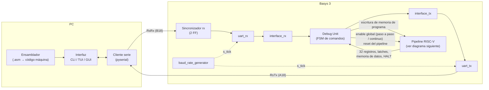
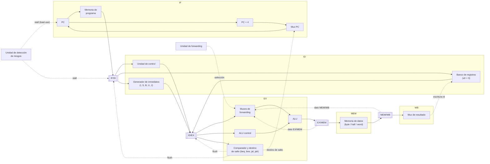
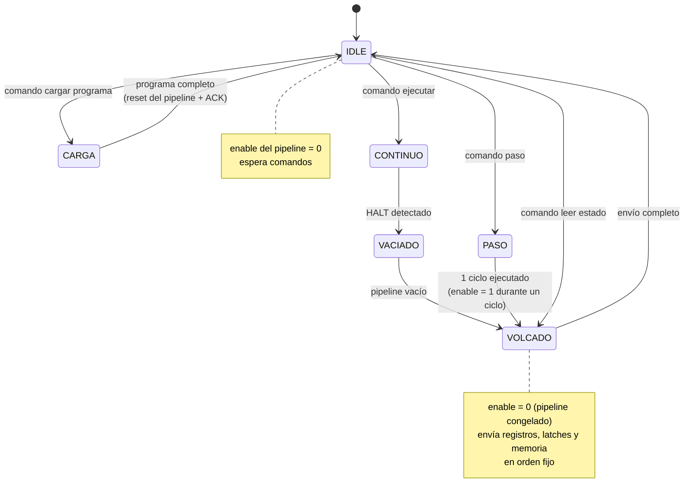

# Plan de trabajo — TP Final: Pipeline RISC-V + Debug Unit

**Equipo:** Molina, Maria Wanda (**A**) · Verdú, Melisa Noel (**B**)
**Placa:** Basys 3 (Artix-7 XC7A35T, clock de 100 MHz, puente USB-UART integrado)
**Repo:** [wandamol1405/AdC-Tps](https://github.com/wandamol1405/AdC-Tps), carpeta `TP-Final/`
**Herramientas:** Vivado, Verilog, Python (pyserial, igual que la GUI del TP2)

> Este archivo vive en el repo y se sincroniza en los Projects de Claude de ambas.
> Después de cada cambio importante: `git push` → la otra hace "Sync now" en su Project.

Leyenda de responsables: **A** = Wanda · **B** = Melisa · **A+B** = juntas

---

## Diagrama en bloques

> Primera versión, para discutir en la Fase 2. GitHub renderiza estos diagramas Mermaid directamente.

### Sistema completo



El clock de 100 MHz (o el que salga del Clock Wizard en la Fase 7) llega igual a todos los bloques. El modo paso a paso se resuelve con la señal de **enable**, nunca cortando el clock.

### Pipeline RISC-V



Decisiones abiertas que muestra el diagrama (registrar en `docs/decisiones.md`):

- **Dónde se resuelven los saltos:** en EX (como está dibujado, penalidad de 2 ciclos) o adelantado a ID (1 ciclo, pero requiere forwarding hacia ID).
- **Cómo se detecta HALT:** al decodificarse en ID o al llegar a WB. Para que el pipeline quede vacío al terminar conviene frenar el PC al ver HALT y esperar a que llegue a WB.
- **Memorias:** IP Block Memory de Vivado o registros inferidos. La memoria de programa necesita un segundo puerto (o un mux) para que la Debug Unit la escriba.

### Modelo de control: comando → respuesta (decisión tomada)

El TP2 funciona "a demanda": al cambiar A o B la salida cambia sola y `result_sender` envía cada vez que detecta un cambio. Ese modelo **no se usa** en el TP final, porque:

- El estado del pipeline cambia en cada ciclo de clock: enviar "cuando cambia" saturaría la UART.
- Un volcado (registros + latches + memoria) son cientos de bytes y tiene que corresponder a **un único ciclo**.
- `result_sender` descarta estados intermedios; en paso a paso cada ciclo tiene que verse.
- El paso a paso y la carga de programa necesitan órdenes explícitas, con el procesador detenido.
- Si la FPGA envía cuando quiere, la PC no sabe cuántos bytes esperar y puede desalinearse.

Reglas del nuevo modelo:

1. **La PC es la maestra.** La FPGA nunca envía datos sin que se los pidan.
2. **La Debug Unit es la única que maneja el enable del pipeline.** El pipeline no avanza si ella no lo habilita.
3. **Durante el volcado el pipeline está congelado** (enable = 0), así todos los datos son del mismo ciclo.
4. **Toda respuesta tiene formato fijo** (por ejemplo: cabecera + longitud + datos + checksum opcional), definido en `docs/protocolo.md`.
5. **La carga de programa se hace con el procesador detenido**, y al terminar se resetea el pipeline.

Esquema de estados de la Debug Unit (primera versión):



Del TP2 se reutiliza: handshake con la bandera de `interface_tx`, estructura de FSM de `loader_uart`, sincronizador de `rx` y la idea de la "foto" para garantizar consistencia.

A definir en la Fase 2: qué pasa si no hay HALT (¿límite de ciclos? ¿comando de parada desde la PC?) y si después de cada paso se vuelca todo automáticamente o la PC lo pide aparte.

---

## Fase 0 — Organización (semana 1)

- [ ] **A+B** Crear la carpeta `TP-Final/` con la estructura de abajo
- [ ] **A+B** Agregar un `.gitignore` en la raíz del repo (hoy no hay) para Vivado: `.runs/`, `.cache/`, `.sim/`, `.Xil/`, `.hw/`, `.ip_user_files/`, `*.jou`, `*.log`, `*.bit`
- [ ] **A+B** Convenciones: prefijos `i_` / `o_` (como en TP1/TP2), reset sincrónico activo alto, ramas (`main` + una rama por feature, merge por pull request)
- [ ] **A+B** Conectar el repo a ambos Projects de Claude y excluir PDFs e imágenes al configurar archivos
- [ ] **A+B** Crear `TP-Final/docs/decisiones.md`
- [ ] **A+B** Crear issues y milestones en GitHub a partir de este plan

## Fase 1 — Revisión de TPs anteriores (semana 1)

Objetivo: decidir, módulo por módulo, si se reutiliza tal cual, se adapta o se reescribe. Primera revisión del código actual del repo ya incluida.

### TP1/TP2 — ALU (`TP2/rtl/ALU.v`)

- [x] Ancho parametrizable (`NB_DATA`): se instancia con 32 bits
- [x] Es combinacional pura
- [ ] **Quitar la saturación en ADD:** hoy satura ante overflow; en RISC-V `add`/`addi` tienen que dar la vuelta (wrap-around) sin excepción
- [ ] **Agregar operaciones faltantes:** `SLL`, `SLT`, `SLTU`
- [ ] **NOR** no se usa en RISC-V (se puede dejar o sacar)
- [ ] **Opcodes:** son los de MIPS (`100000` = ADD, etc.). Definir una codificación propia y un módulo **ALU control** que la genere desde opcode/funct3/funct7
- [ ] **Shifts:** limitar el monto a `i_b[4:0]` (en RV32 solo cuentan los 5 bits bajos)
- [ ] Revisar si `i_enable` y las banderas `o_overflow` / `o_carry` siguen haciendo falta (RISC-V no usa flags; los saltos comparan directo)
- [ ] Ampliar `TP1/sim/tb_ALU.v` con los casos nuevos

### TP2 — UART

- [x] `baud_rate_generator` es parametrizable (`CLK_FREQ`, `BAUD_RATE`)
- [x] El sincronizador de `rx` (2 FF con `ASYNC_REG`) existe, pero está en `top.v`: **moverlo** o copiarlo al top del TP final
- [ ] Decidir velocidad: hoy es 19200. A 115200 con 100 MHz el divisor da 54,25 → se trunca a 54 (~0,5 % de error, aceptable). Recalcular cuando cambie el clock en la Fase 7
- [ ] `uart_rx`, `uart_tx`, `interface_rx`, `interface_tx`: reutilizar tal cual, verificando que sus testbenches pasen
- [ ] `interface_tx` guarda un solo byte: evaluar si hace falta un **FIFO** para enviar registros + latches + memoria sin trabar a la Debug Unit
- [ ] `loader_uart` y `result_sender` se reemplazan por la **Debug Unit**, pero su estructura de FSM (comando + valor, envío de bytes con bandera de ocupado) sirve de base. Ojo: `result_sender` envía "cuando cambia" la ALU; ese comportamiento no se mantiene (ver modelo comando → respuesta)
- [ ] GUI del TP2 (`TP2/gui/`): reutilizar `serial_link.py`, la idea de `protocol.py` y el `mock_fpga.py` para probar la interfaz sin placa

### General

- [ ] ¿Pasan los testbenches originales?
- [ ] Revisar warnings de síntesis (latches inferidos, señales sin usar)
- [ ] Registrar resultado en `docs/decisiones.md`: **reutilizar / adaptar / reescribir**, con el motivo

## Fase 2 — Diseño en papel (semana 2)

- [ ] **A+B** Cerrar el diagrama en bloques de arriba (decisiones abiertas incluidas)
- [ ] **A+B** Definir contenido de cada latch (IF/ID, ID/EX, EX/MEM, MEM/WB)
- [ ] **A+B** Estrategia de riesgos: forwarding, detección de load-use (stall), saltos (flush)
- [ ] **A+B** Documentar en `docs/decisiones.md` el paso del modelo "a demanda" del TP2 al modelo comando → respuesta (ver sección de arriba)
- [ ] **A+B** Cerrar los estados y transiciones de la FSM de la Debug Unit
- [ ] **A+B** Definir protocolo UART PC ↔ FPGA (`docs/protocolo.md`): lista de comandos, formato de respuesta (cabecera, longitud, datos, checksum), ACK/errores y orden fijo del volcado
- [ ] **A+B** Definir cómo se implementa el modo paso a paso sin tocar el clock (enable global manejado solo por la Debug Unit)
- [ ] **A+B** Elegir codificación de HALT
- [ ] **A+B** Responder preguntas de reprogramación: ¿vaciar memoria de datos, registros, pipeline, memoria de programa?

## Fase 3 — Pipeline (semanas 3–5) · paralelo con Fase 4

Cada módulo con su testbench antes de integrar.

- [ ] **A** IF: PC, memoria de programa (evaluar IP Block Memory), sumador PC+4
- [ ] **A** ID: banco de registros (x0 siempre en 0), unidad de control, generador de inmediatos (I, S, B, U, J)
- [ ] **B** EX: ALU adaptada (Fase 1), ALU control, mux de operandos, cálculo de destino de saltos
- [ ] **B** MEM: memoria de datos con accesos byte/half/word (sb, sh, sw, lb, lh, lw, lbu, lhu)
- [ ] **B** WB: mux de resultado
- [ ] **A** Latches entre etapas, con enable y flush
- [ ] **A** Unidad de forwarding
- [ ] **B** Unidad de detección de riesgos (stall load-use, flush en saltos)
- [ ] **A+B** Integración del pipeline y simulación con programas de prueba por tipo de instrucción

## Fase 4 — Ensamblador e interfaz en PC (semanas 3–5) · paralelo con Fase 3

- [ ] **B** Ensamblador: texto → código máquina para todas las instrucciones pedidas + HALT
- [ ] **B** Validar el ensamblador comparando contra uno de referencia (ej. RARS o Venus)
- [ ] **A** Cliente UART en PC (partiendo de `TP2/gui/serial_link.py`)
- [ ] **A** Interfaz (CLI / TUI / GUI): carga de programa, modo continuo, paso a paso, visualización de registros, latches y memoria
- [ ] **A** Mock de la FPGA para probar la interfaz sin placa (como `TP2/gui/mock_fpga.py`)
- [ ] **A+B** Programas de prueba en assembly (uno por grupo de instrucciones + casos de riesgos)

## Fase 5 — Debug Unit (semana 6)

- [ ] **A** FSM de la Debug Unit: estado IDLE y decodificación de comandos
- [ ] **A** Estado CARGA: escritura de memoria de programa por UART con el procesador detenido + reset del pipeline al terminar
- [ ] **B** Estado VOLCADO: pipeline congelado y envío de registros, latches y memoria en orden fijo, con el formato de respuesta del protocolo
- [ ] **B** Estados CONTINUO + VACIADO: ejecutar hasta HALT y esperar a que el pipeline quede vacío
- [ ] **A** Estado PASO: enable activo durante exactamente un ciclo por comando
- [ ] **A+B** Comportamiento si no hay HALT en memoria
- [ ] **A+B** Testbench de la Debug Unit simulando la PC (secuencias de comandos completas)

## Fase 6 — Integración en la Basys 3 (semana 7)

- [ ] **A+B** Constraints (`.xdc`): clock (W5), RsRx (B18), RsTx (A18), reset — partir de `TP2/constraints/constraints.xdc`
- [ ] **A+B** Síntesis e implementación sin errores
- [ ] **A+B** Pruebas en placa con la interfaz y todos los programas de prueba
- [ ] **A+B** Prueba de reprogramación dinámica (cargar varios programas seguidos)

## Fase 7 — Timing y clock (semana 8)

- [ ] **A+B** Identificar el camino crítico (Timing Report en Vivado)
- [ ] **A+B** Analizar skew y sus consecuencias
- [ ] **A+B** Encontrar la frecuencia óptima y generarla con Clock Wizard
- [ ] **A+B** Ajustar `CLK_FREQ` del baud rate generator a la nueva frecuencia
- [ ] **A+B** Registrar métricas (WNS, TNS, utilización, potencia)

## Fase 8 — Documentación y entrega (semana 9)

- [ ] **A+B** README del TP con el mismo formato que TP1/TP2 (capturas de testbench, esquemático RTL, timing)
- [ ] **A+B** Informe: arquitectura, decisiones, riesgos, protocolo, resultados de timing
- [ ] **A+B** Respuestas a todas las preguntas de la consigna
- [ ] **A+B** Video o demo de funcionamiento

---

## Estructura de `TP-Final/`

```
TP-Final/
  PLAN.md
  README.md
  rtl/          módulos Verilog (pipeline, debug unit, uart, top)
  sim/          testbenches (mismo nombre que en TP1/TP2)
  constraints/  .xdc de la Basys 3
  gui/          interfaz en PC + cliente serie + mock
  assembler/    ensamblador
  programs/     programas de prueba en assembly
  images/       capturas para el README
  docs/
    decisiones.md
    protocolo.md
```

## Preguntas de la consigna a responder (checklist)

- [ ] ¿Es necesario vaciar la memoria de datos al reprogramar?
- [ ] ¿Y los registros?
- [ ] ¿Se necesita vaciar el pipeline?
- [ ] ¿Y la memoria de programa?
- [ ] ¿Qué sucede si en la memoria no hay instrucción de parada?
- [ ] ¿Cuál es el camino crítico del sistema?
- [ ] ¿Genera skew? ¿Qué consecuencias tiene?
